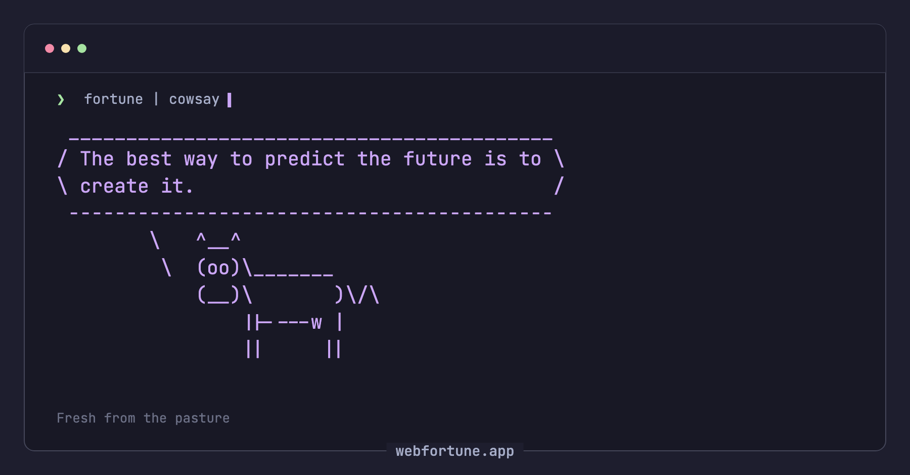
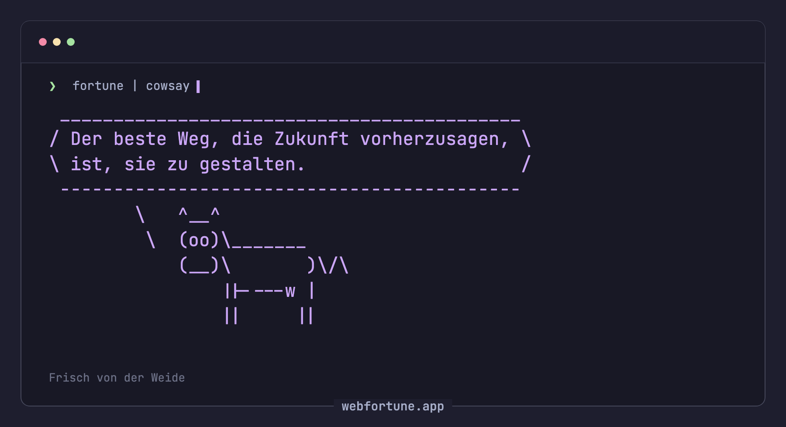
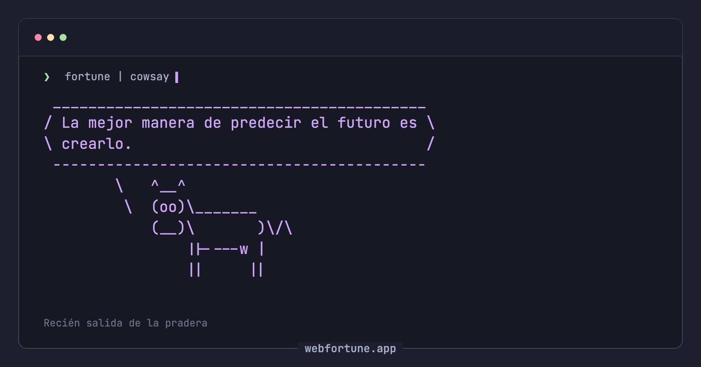
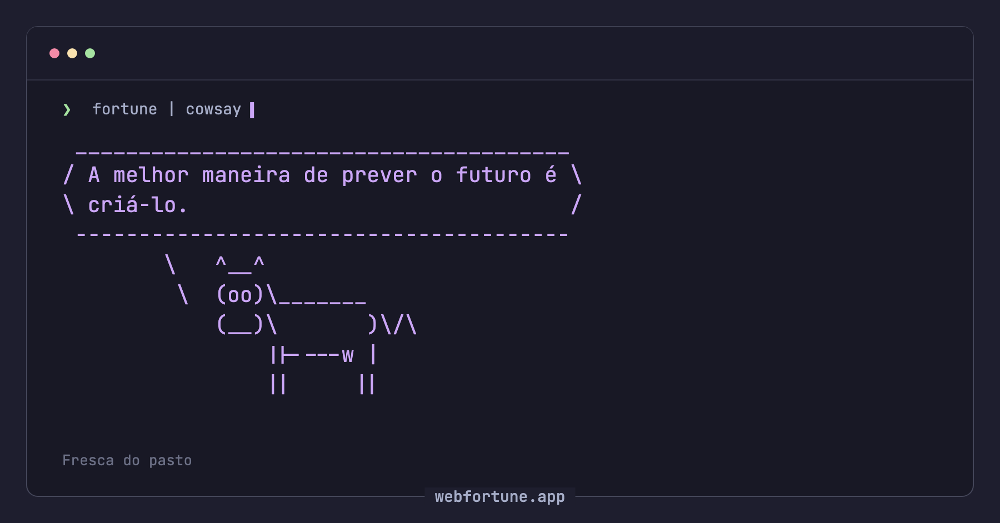

# webfortune

A little wisdom. A lot of moo. A Rust `fortune` API on Cloudflare Workers and a Catppuccin Mocha web UI on GitHub Pages.

Production: [webfortune.app](https://webfortune.app/)

## Screenshots

| English | Deutsch |
| --- | --- |
|  |  |
| Español | Português |
|  |  |

The browser renders fortunes in a responsive cowsay-style ASCII bubble, with cow and category selection, copy, keyboard shortcuts, and accessible loading/error states. Fortune text is always rendered as text, never HTML.

## Local development

Install [Nix](https://nixos.org/download/) with flakes (or use [`direnv`](https://direnv.net/) + `.envrc`), plus Node.js 24+. The Nix shell provides Rust/wasm tooling and the Debian fortune/cowsay data used to generate Worker assets.

```sh
nix develop
npm ci
npm run generate:assets
npm run worker:dev
# In another terminal; Vite proxies /api to wrangler on :8787.
npm run dev
```

Open the Vite URL. The UI defaults to `/api`, which Vite forwards to the local Worker. Production builds require `VITE_API_URL=https://api.webfortune.app`.

## API

| Request | Response |
| --- | --- |
| `GET /` | Random fortune as UTF-8 plain text. The response includes `x-fortune-id`, for example `computers-42`. |
| `GET /?fortune=computers-42` | That exact fortune. Invalid ids are 400; an unknown database or out-of-range index is 404. |
| `GET /og.png?locale=en&fortune=computers-42&cow=tux` | 1200×630 PNG of that cow saying that fortune. Omit `fortune` for the branded card. |
| `GET /?category=computers` | Fortune from an installed category |
| `GET /categories` | JSON array of installed category names |
| `GET /cows` | JSON array of installed cow names |
| `GET /cows/{name}` | ASCII artwork for an installed cow |
| `GET /health` | `{"status":"ok"}` when fortune data is available |

A fortune id is `<database>-<index>`. The index is a decimal with no leading zeros. Database names use the same resource-name rules as categories and may contain hyphens, so the id is split on the last hyphen. `locale` and `category` still work alongside `fortune`; when a category is set, the id's database must be that category.

The page stores the served id in a `fortune` query parameter, next to `locale`, `cow`, and `category`. The copy button includes that URL, so opening it shows the same fortune. Refresh and Space request a new random fortune and replace the id. An invalid or unknown id falls back to a random fortune.

GET and HEAD are supported. The Worker handles browser OPTIONS and CORS, and exposes `x-fortune-id` to allowed origins. Invalid queries return 400, unknown routes and categories 404, and other methods 405 with `Allow: GET, HEAD`. HEAD has the same status and headers as GET, including `Content-Length`, and an empty body. Rate limiting is per client IP and counts HEAD the same way as GET.

## Deployment

See [the deployment runbook](docs/deployment.md). `Deploy production` runs after a successful Release (or on manual dispatch). It deploys the Cloudflare Worker to `api.webfortune.app`, smoke-tests the public API/CORS, builds the UI with that API URL, and publishes GitHub Pages. Worker failure blocks the Pages deployment. Deployments are serialized.

For a standalone production UI build:

```sh
VITE_API_URL=https://api.webfortune.app npm run build
```

Builds fail without a public HTTPS API URL. Assets use relative paths so the site works at both `webfortune.app` and the GitHub Pages project path. `VITE_API_URL` is public configuration, not a secret.

## Verification

```sh
nix develop
npm test
npx playwright install chromium
npm run test:e2e
npm run generate:assets
npm run worker:dev   # then, in another shell:
API_URL=http://127.0.0.1:8787 CORS_ORIGIN=https://webfortune.app npm run smoke
API_URL=https://api.webfortune.app CORS_ORIGIN=https://webfortune.app npm run smoke
```

Browser tests cover desktop/mobile layout, category selection, retry, preserving the previous fortune after a failure, and safe rendering of HTML-like text. CI builds the Worker (including a wrangler dry-run) and smoke-tests it locally.
