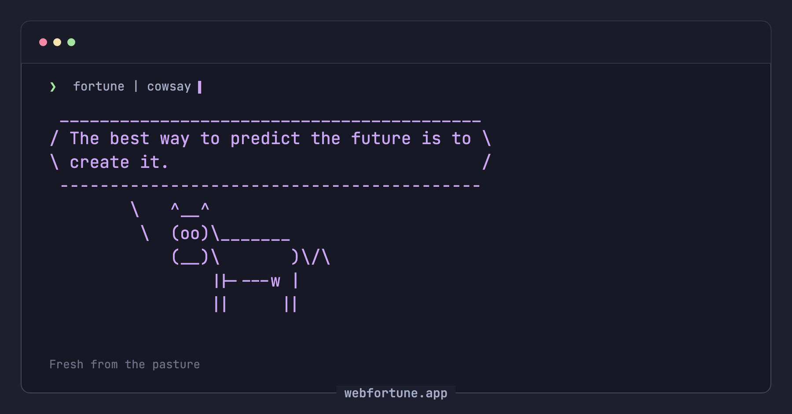
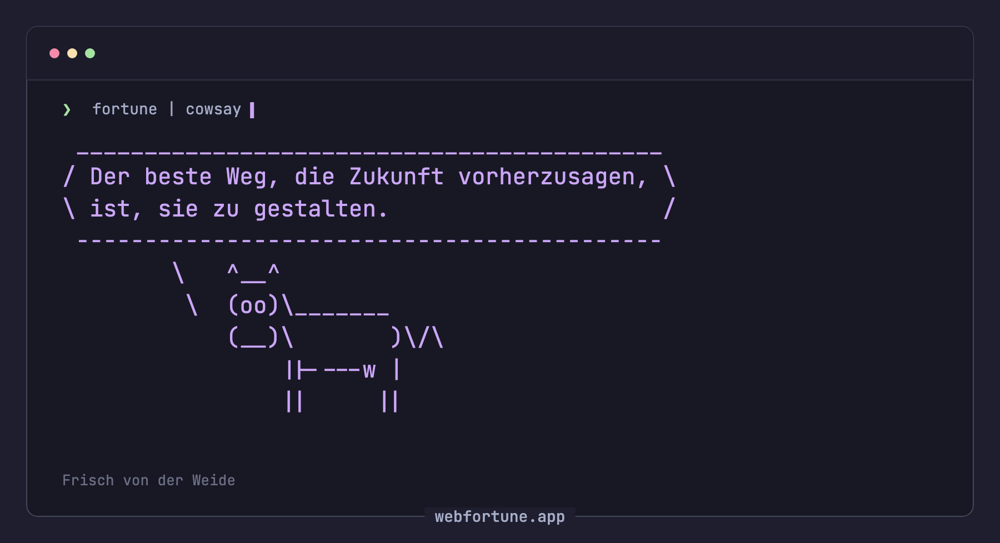
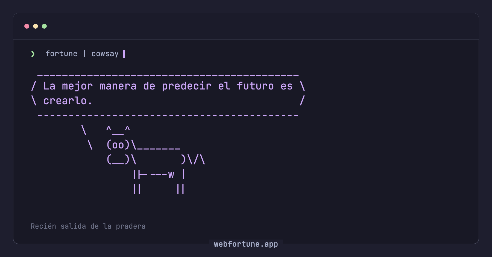
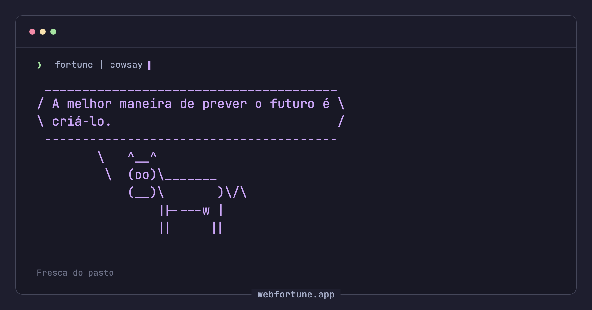

# webfortune

A little wisdom. A lot of moo. A Rust `fortune` API on Cloudflare Workers and a Catppuccin Mocha web UI on GitHub Pages.

Production: [webfortune.app](https://webfortune.app/)

## Screenshots

| English | Deutsch |
| --- | --- |
|  |  |
| Español | Português |
|  |  |

The browser renders fortunes in a responsive cowsay-style ASCII bubble, with cow and category selection, copy, keyboard shortcuts, and accessible loading/error states. Fortune text is always rendered as text, never HTML.

## Local development

Install [Nix](https://nixos.org/download/) with flakes (or use [`direnv`](https://direnv.net/) + `.envrc`), plus Node.js 24+. The Nix shell provides Rust/wasm tooling and the Debian fortune/cowsay data used to generate Worker assets.

```sh
nix develop
npm ci
npm run generate:assets
npm run worker:dev
# In another terminal; Vite proxies /api to wrangler on :8787.
npm run dev
```

Open the Vite URL. The UI defaults to `/api`, which Vite forwards to the local Worker. Production builds require `VITE_API_URL=https://api.webfortune.app`.

## API

| Request | Response |
| --- | --- |
| `GET /` | Random fortune as UTF-8 plain text. The response includes `x-fortune-id`, for example `computers-42`. |
| `GET /?fortune=computers-42` | That exact fortune. Invalid ids are 400; an unknown database or out-of-range index is 404. |
| `GET /?format=json` | The same fortune as one JSON object: `{"id":"computers-42","fortune":"...","locale":"en","category":"computers"}`. `Content-Type` is `application/json; charset=utf-8`, and `x-fortune-id` is still set. |
| `GET /?format=cowsay` | The same fortune as cowsay-style ASCII: a speech bubble and the cow. `Content-Type` is `text/plain; charset=utf-8`, the body ends with a newline, and `x-fortune-id` is still set. `cow=tux` selects an installed cow; omit `cow` for `default`. An invalid cow name is 400 and an unknown cow is 404. |
| `GET /og.png?locale=en&fortune=computers-42&cow=tux` | 1200×1200 PNG of that cow saying that fortune. Omit `fortune` for the branded card. |
| `GET /?category=computers` | Fortune from an installed category |
| `GET /?length=short` | Random fortune whose plain-text body is at most 160 bytes (`fortune -s`). `length=long` returns one longer than 160 bytes (`fortune -l`). `x-fortune-id` is still set. |
| `GET /categories` | JSON array of installed category names |
| `GET /cows` | JSON array of installed cow names |
| `GET /cows/{name}` | ASCII artwork for an installed cow |
| `GET /health` | `{"status":"ok","version":"<x.y.z>"}` when fortune data is available. `version` is the release the Worker was built from (`package.json`, no leading `v`). |

A fortune id is `<database>-<index>`. The index is a decimal with no leading zeros. Database names use the same resource-name rules as categories and may contain hyphens, so the id is split on the last hyphen. `locale` and `category` still work alongside `fortune`; when a category is set, the id's database must be that category. A request that sets both `fortune` and `length` is 400.

`format=json` and `format=cowsay` combine with `locale`, `category`, and `fortune` and select the same fortune as the plain-text response. In the JSON object, `fortune` is that plain-text body and `category` is the database it came from. `format=cowsay` wraps that text in the speech bubble the web UI uses (width 44) and appends the cow artwork from `GET /cows/{name}`. `cow` is accepted only together with `format=cowsay`; on any other request it is rejected like an unsupported parameter. Leave `format` off to keep the plain-text body. Any other `format` value is 400. `length=short` and `length=long` combine with `locale`, `category`, and `format` (including `cow` when the format is `cowsay`) and select the same fortune the plain-text response would return for that query, with `x-fortune-id` still set. Selection is uniform over the matching fortunes in the locale and, when set, the category: each database is weighted by how many of its fortunes match, the same way an unfiltered request weights databases by size. Length is the UTF-8 byte length of the plain-text body, including newlines and excluding the strfile `%` delimiter. That is the count fortune(6) uses for `-s` and `-l`. The default short limit (SLEN) is 160 bytes, so `short` is at most 160 bytes and `long` is longer than 160. Those index lists are computed when Worker assets are generated. Leave `length` off to draw from every fortune. Any other `length` value is 400, a repeated `length` is rejected like any other repeated parameter, and a locale or category with no fortune of that length is 404. Error responses stay plain text.

The page stores the served id in a `fortune` query parameter, next to `locale`, `cow`, and `category`. The copy button includes that URL, so opening it shows the same fortune. Refresh and Space request a new random fortune and replace the id. An invalid or unknown id falls back to a random fortune.

GET and HEAD are supported. The Worker handles browser OPTIONS and CORS, and exposes `x-fortune-id` to allowed origins. Invalid queries return 400, unknown routes and categories 404, and other methods 405 with `Allow: GET, HEAD`. HEAD has the same status and headers as GET, including `Content-Length`, and an empty body. Rate limiting is per client IP and counts HEAD the same way as GET.

## Deployment

See [the deployment runbook](docs/deployment.md). A new `vX.Y.Z` tag publishes GitHub Pages. Workers Builds runs `npm run worker:deploy` for that release commit. Deployments are serialized.

For a standalone production UI build:

```sh
VITE_API_URL=https://api.webfortune.app npm run build
```

Builds fail without a public HTTPS API URL. Assets use relative paths so the site works at both `webfortune.app` and the GitHub Pages project path. `VITE_API_URL` is public configuration, not a secret.

`VITE_GA_MEASUREMENT_ID` is optional. Set it to the GA4 measurement ID (`G-…`) to include the Google tag and consent banner. The tag is on the page immediately, and analytics storage stays denied until a visitor allows it. Leave it unset for local development.

## Verification

```sh
nix develop
npm test
npx playwright install chromium
npm run test:e2e
npm run generate:assets
npm run worker:dev   # then, in another shell:
API_URL=http://127.0.0.1:8787 CORS_ORIGIN=https://webfortune.app npm run smoke
API_URL=https://api.webfortune.app CORS_ORIGIN=https://webfortune.app npm run smoke
```

Browser tests cover desktop/mobile layout, category selection, retry, preserving the previous fortune after a failure, and safe rendering of HTML-like text. CI builds the Worker (including a wrangler dry-run) and smoke-tests it locally.
